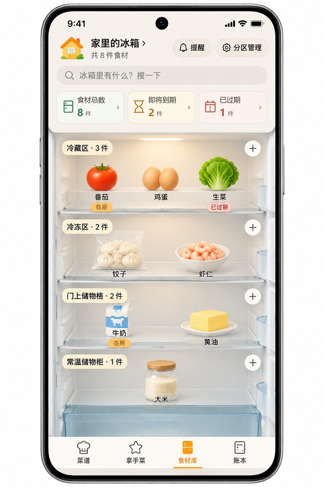
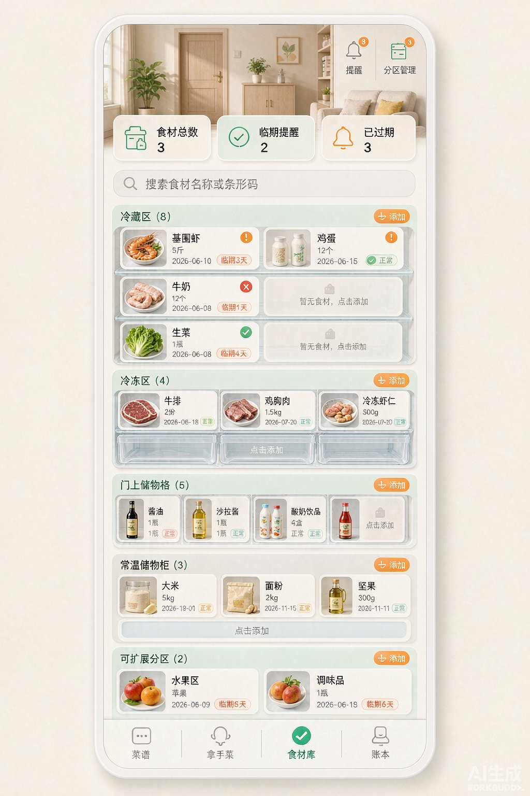
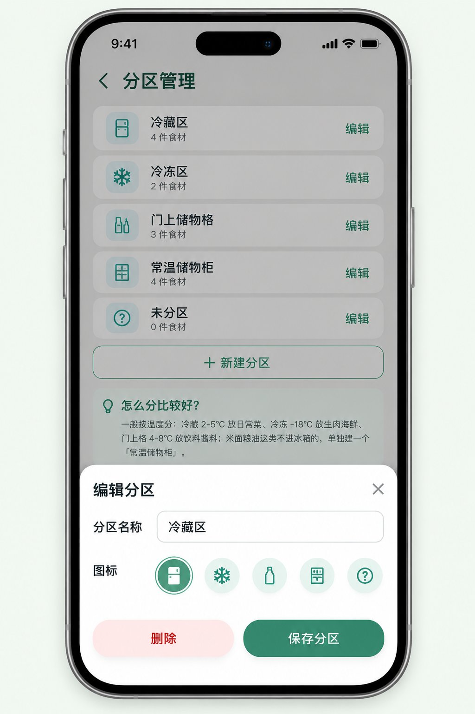

# tutu-wx-miniprogram

微信小程序开发工作流 Skill。把「想法 → PRD → 设计规范 → 页面终稿 → 真代码 → 验证」这条链路固定下来，避免边写边改、多页风格不统一、交付时说不清做了没做。HTML 视觉稿只在需要时做，不是必经步骤。

采用 Agent Skill 通用格式（`SKILL.md` + `references/`），不绑定某个特定智能体：Claude Code、Codex、Cursor、WorkBuddy 等能吃本地指令文件的工具都能用；不用智能体时，它本身也是一份可读的小程序开发规范。

## 它解决什么

| 常见问题 | 这份 skill 的做法 |
|---|---|
| 一上来就写代码，写到一半发现页面结构错了 | 先 PRD，再设计规范，视觉基准确认后才写代码 |
| 每页颜色、字号、间距都不一样 | 视觉取值只在 `design.md` 里定义一次，页面只引用 |
| 原型好看，代码做出来走样 | 一致性契约：数值同源、禁止裸值、结构不优化、文案不改、像素差 ≤2rpx |
| 各种文案 AI 味儿太重 | 语气是产品级决定，没指定就默认滑稽档并全站统一；另有 AI 腔黑名单（强行升华、排比堆叠、集体人称） |
| 新功能做完，把老页面改坏了 | 开工先写影响面，按波及面决定回归范围 |
| 只有一张设计图，不知道怎么落到代码 | 按页拆素材清单 + 写前端还原方案，再进开发 |
| 交付时说"做完了"，但缺状态、缺兜底 | 交付前逐条对照 PRD，查页面、功能点、四态、兜底 |

## 小程序设计图示例

设计图是画给人看、同时作为代码唯一视觉依据的稿子：一屏一张，放在一部完整手机里，按真实设备比例出。页面结构和交互在这一版定下来之后，代码就照着它落地，不再二次创作。

下面是同一个「家里的冰箱」食材库小程序的三张设计图，**示例项目，不在本仓库内**。







从这三张图能看出几件事：

- **一部完整手机、一屏一个页面**：外框、状态栏、底部 tabBar 都在位，看的是用户真实看到的那一屏，不是一块悬在画布上的组件
- **同一页给出两种密度**：一个按冰箱位置分层，一个按分区汇总数量，同一份数据两种读法，各自解决不同的查找场景
- **统计卡是入口，不是装饰**：食材总数 / 临期 / 过期各一张卡，点进去就是筛好的清单
- **弹层也画在设计图里**：改分区名的编辑态、图标选择、删除与保存，都在稿子上定过，不在代码里现场发明
- **文案写真话**：番茄挂「临期」、生菜挂「已过期」，标签和统计卡的数字对得上——这些字会原样进代码
- **取值只有一套**：主色、页面底色、字号、圆角统一来自 `design.md`，页面只是引用方

> 图里的颜色、文案、分区是那个示例项目的决定，不是这份 skill 的规定。你的项目该用什么是 `design.md` 里定的事。需要先做可点的 HTML 稿时，标准见 `references/html-prototype.md`（单文件、多屏并排、四态齐）。

## 安装

`SKILL.md` 是入口，`references/` 是按需查阅的细则。

把这句话直接发给你在用的 agent：

```text
请把这个 skill 部署到本地：https://github.com/tutu-PM/tutu-wx-miniprogram
```

它知道自己的 skills 目录在哪，会自己克隆过去放好，不用你翻路径。Claude Code、Codex、WorkBuddy 这类能读写本地文件的工具都能这么装。

放好后目录结构应为 `<skills 目录>/tutu-wx-miniprogram/SKILL.md`，重启会话后按名字加载。

## 目录结构

```text
tutu-wx-miniprogram/
├── SKILL.md                      主流程与硬约束（先读这份）
├── assets/                       小程序设计图示例（README 用）
└── references/
    ├── from-scratch.md           从 0 开发：划 MVP、定技术栈
    ├── existing-project.md       存量项目：新增功能与小改动的边界
    ├── prototype-to-code.md      已有原型 → 小程序代码
    ├── prd.md                    PRD 模板：定位、页面、功能、状态、兜底
    ├── design.md                 设计规范模板：颜色、字号、间距、按钮三态、动效
    ├── style-presets.md          风格参考套餐（暖食/清爽/卡通/专业，可自定义）
    ├── visual-language.md        视觉语言：页面骨架、显乱的八个症状
    ├── image-prompt-template.md  页面效果图提示词：三方向探索、延展、局部改图
    ├── asset-inventory.md        按页拆素材：先定清单，再授权制作
    ├── design-to-code.md         设计图转前端：分工、样板、验收与缺项
    ├── html-prototype.md         HTML 视觉稿：按需制作，单文件、多屏并排、四态齐
    ├── consistency.md            稿码一致性契约：七条硬约束 + 差异白名单
    ├── copywriting.md            文案语气：产品级口吻、安全红线、禁用词
    ├── motion.md                 动效细则：三处动效、时长曲线、小程序专属坑
    ├── imagery.md                图片素材：生图边界、尺寸与格式
    ├── platform-ui.md            平台约束：原生组件、rpx、安全区、包体积
    ├── project-layout.md         目录规范与 git 检测
    ├── competitive-analysis.md   竞品分析写法
    └── verify.md                 验证与假故障排查
```

## 主流程（六步）

```text
0. 建目录 + 探 git + 定设计规范
1. 写 PRD
2. 确认开发依据（材料齐了直接做，HTML 只在需要时做）
3. 写真代码样板页 + 模拟器/真机截图
4. 铺其余页面
5. 验证
6. 交付，逐条对照 PRD
```

## 几条硬约束

1. **项目目录固定**：`01需求文档 / 02视觉风格（design.md + 设计图 + 原型 + 素材）/ 03代码`。设计图给人看，素材给代码用，原型按需建；代码里的 static 是副本。
2. **开工先探 git**：`git --version` + `git rev-parse --show-toplevel`；只问一次，不代装。
3. **先确认再开发，HTML 按需**：正式视觉稿确认、交互清楚，直接写真实样板页。只有明确要求，或某个交互必须点一下才能决定时，才做最小范围原型。新增页面和跨页改动照样先写影响面、扩大回归，但不按页数强制出稿。
4. **HTML 稿不等于验收**：稿在浏览器里跑，验不了真机裁切、点击区、掉帧。
5. **一致性契约**：代码里不许有裸颜色、裸 px、裸圆角、裸时长曲线；结构不顺手优化；文案一字不改（标点也算）。动效三处必须逐处点亮过，只看代码不算验过。
6. **不允许说"像素级还原"**：正确说法是「源头同源 + 像素差 ≤2rpx + 差异白名单」。
7. **文案语气全站统一**：用户没指定就默认滑稽档，写 PRD 时定一次；唯一例外是用户点名某处改文案；出错、删除确认、金额、隐私授权用同一口吻的低调档，不切回公文腔。
8. **新增功能先写影响面**：关联了哪些现有功能、在哪一屏出现、会改坏什么、要不要动共用件。

## 什么时候不要用

- 只改一句文案、调一个间距、删一个元素 → 直接改
- 需求已经明确到"改成什么样" → 直接改
- 不覆盖服务端、云开发部署，也不覆盖小程序 AI 模式

## 版本

`0.2.0`，见 `SKILL.md` frontmatter。规则本身不写死任何框架 API，默认开发端为手机端。
