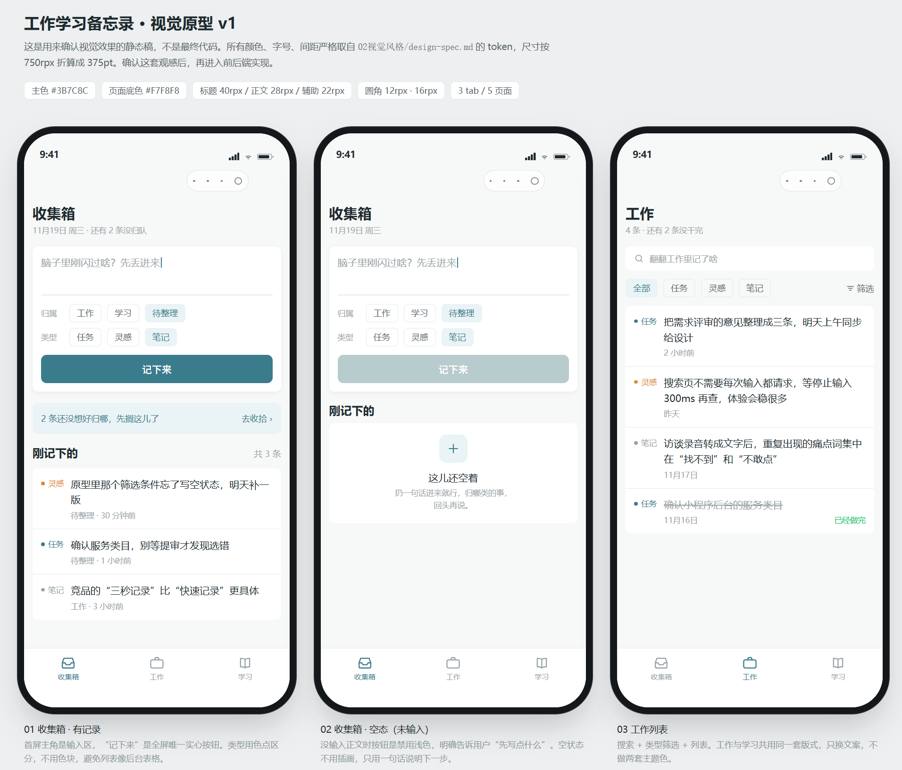
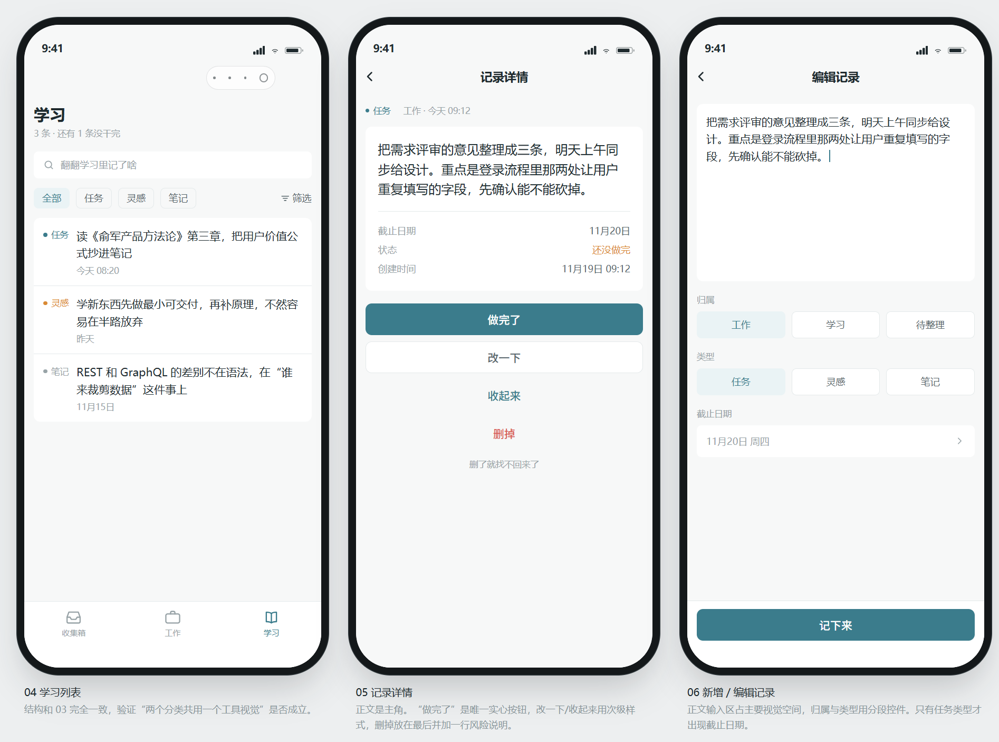

# tutu-wx-miniprogram

微信小程序开发工作流 Skill。把「想法 → PRD → 设计规范 → HTML 视觉稿 → 真代码 → 验证」这条链路固定下来，避免边写边改、多页风格不统一、交付时说不清做了没做。

采用 Agent Skill 通用格式（`SKILL.md` + `references/`），不绑定某个特定智能体：Claude Code、Codex、Cursor、WorkBuddy 等能吃本地指令文件的工具都能用；不用智能体时，它本身也是一份可读的小程序开发规范。

## 它解决什么

| 常见问题 | 这份 skill 的做法 |
|---|---|
| 一上来就写代码，写到一半发现页面结构错了 | 先 PRD，再设计规范，再 HTML 视觉稿，最后才写代码 |
| 每页颜色、字号、间距都不一样 | 视觉取值只在 `design-spec.md` 里定义一次，页面只引用 |
| 原型好看，代码做出来走样 | 一致性契约：数值同源、禁止裸值、结构不优化、文案不改、像素差 ≤2rpx |
| 各种文案 AI 味儿太重 | 语气是产品级决定，开工定一次全站统一；另有 AI 腔黑名单（强行升华、排比堆叠、集体人称） |
| 新功能做完，把老页面改坏了 | 开工先写影响面，按波及面决定要不要先出稿 |
| 交付时说"做完了"，但缺状态、缺兜底 | 交付前逐条对照 PRD，查页面、功能点、四态、兜底 |

## 产出示例：HTML 视觉稿

写代码之前，先出这样一版稿子：单文件、多屏并排、每屏一句说明。





上面是一个「工作 / 学习记录」小程序的视觉稿，**示例项目，不在本仓库内**。从稿子能看出几件事：

- **多屏并排，一屏一个真实场景**，不是一堆孤立组件
- **每屏下方写清这屏在验证什么**，不是只画个界面
- **顶栏标明取值来源**：主色、页面底色、字号、圆角都来自 `design-spec.md`，稿子只是引用方
- **四态齐全**：第 2 屏就是空态，加载与出错在稿子里另有对照屏
- **文案写真话**：没有「暂无数据」「请输入内容」这类占位词——这些字一旦进稿子，就会原样进代码

> 稿子里的具体颜色、文案是那个示例项目的决定，不是这份 skill 的规定。你的项目该用什么是 `design-spec.md` 里定的事。

## 怎么用

`SKILL.md` 是入口，`references/` 是按需查阅的细则。

### 装法一：让 agent 自己干（推荐）

把这句话直接发给你在用的 agent：

```text
请把这个 skill 部署到本地：https://github.com/tutu-PM/tutu-wx-miniprogram
装到你这个工具读 skill 的目录，装完把路径告诉我。
```

它知道自己的 skills 目录在哪，会自己克隆过去放好，不用你翻路径。Claude Code、Codex、WorkBuddy 这类能读写本地文件的工具都能这么装。

### 装法二：手动放

各工具的位置不一样：

| 工具 | 放哪里 / 怎么用 |
|---|---|
| **Claude Code** | 个人级放 `~/.claude/skills/tutu-wx-miniprogram/`，项目级放 `<项目>/.claude/skills/tutu-wx-miniprogram/` |
| **WorkBuddy** | 放 `~/.workbuddy/skills/tutu-wx-miniprogram/` |
| **Codex、Cursor 等规则文件驱动的工具** | 没有独立 skill 目录，把 `SKILL.md` 正文并入 `AGENTS.md`（或项目规则文件），并保留一句"细则在 `references/` 下，按需读取" |
| **任意对话式智能体** | 直接把 `SKILL.md` 贴给它，或让它先读这个文件；`references/` 里的细则让它需要时再读 |
| **不用智能体** | 当规范文档读，按主流程自己推进 |

有 skill 目录的两个平台，一条命令就能装：

```bash
# Claude Code（个人级，macOS / Linux）
git clone https://github.com/tutu-PM/tutu-wx-miniprogram ~/.claude/skills/tutu-wx-miniprogram

# WorkBuddy（Windows）
git clone https://github.com/tutu-PM/tutu-wx-miniprogram "%USERPROFILE%\.workbuddy\skills\tutu-wx-miniprogram"
```

放好后目录结构应为 `<skills 目录>/tutu-wx-miniprogram/SKILL.md`，重启会话后按名字加载。

## 目录结构

```text
tutu-wx-miniprogram/
├── SKILL.md                      主流程与硬约束（先读这份）
├── assets/                       产出示例图（README 用）
└── references/
    ├── from-scratch.md           从 0 开发：划 MVP、定技术栈
    ├── existing-project.md       存量项目：新增功能与小改动的边界
    ├── prototype-to-code.md      已有原型 → 小程序代码
    ├── prd.md                    PRD 模板：定位、页面、功能、状态、兜底
    ├── design-spec.md            设计规范模板：颜色、字号、间距、按钮三态、动效
    ├── style-presets.md          风格参考套餐（暖食/清爽/卡通/专业，可自定义）
    ├── visual-language.md        视觉语言：页面骨架、显乱的八个症状
    ├── html-prototype.md         HTML 视觉稿：单文件、多屏并排、四态齐
    ├── consistency.md            稿码一致性契约：七条硬约束 + 差异白名单
    ├── copywriting.md            文案语气：产品级口吻、安全红线、禁用词
    ├── motion.md                 动效细则：三处动效、时长曲线、小程序专属坑
    ├── imagery.md                图片素材：生图边界、尺寸与格式
    ├── platform-ui.md            平台约束：原生组件、rpx、安全区、包体积
    ├── project-layout.md         目录规范与 git 检测
    ├── competitive-analysis.md   竞品分析写法
    └── verify.md                 验证与假故障排查
```

## 主流程（六步）

```text
0. 建目录 + 探 git + 定设计规范
1. 写 PRD
2. 出 HTML 视觉稿（按改动大小决定要不要出）
3. 写真代码样板页 + 模拟器/真机截图
4. 铺其余页面
5. 验证
6. 交付，逐条对照 PRD
```

## 几条硬约束

1. **项目目录固定**：`01需求文档 / 02视觉风格（design-spec + 原型 + 素材）/ 03代码`，素材只放素材库，代码里是副本。
2. **开工先探 git**：`git --version` + `git rev-parse --show-toplevel`；只问一次，不代装。
3. **先出稿再写码**：从 0 到 1、新增页面、跨 2 页以上流程、动到 2 个以上现有页面，必须先出 HTML 视觉稿；改文案、改按钮名、调间距直接改代码。
4. **HTML 稿不等于验收**：稿在浏览器里跑，验不了真机裁切、点击区、掉帧。
5. **一致性契约**：代码里不许有裸颜色、裸 px、裸圆角、裸时长曲线；结构不顺手优化；文案一字不改（标点也算）。动效三处必须逐处点亮过，只看代码不算验过。
6. **不允许说"像素级还原"**：正确说法是「源头同源 + 像素差 ≤2rpx + 差异白名单」。
7. **文案语气全站统一**：唯一例外是用户点名某处改文案；出错、删除确认、金额、隐私授权用同一口吻的低调档，不切回公文腔。
8. **新增功能先写影响面**：关联了哪些现有功能、在哪一屏出现、会改坏什么、要不要动共用件。

## 什么时候不要用

- 只改一句文案、调一个间距、删一个元素 → 直接改
- 需求已经明确到"改成什么样" → 直接改
- 不覆盖服务端、云开发部署，也不覆盖小程序 AI 模式

## 版本

`0.1.0`，见 `SKILL.md` frontmatter。规则本身不写死任何框架 API，默认开发端为手机端。
