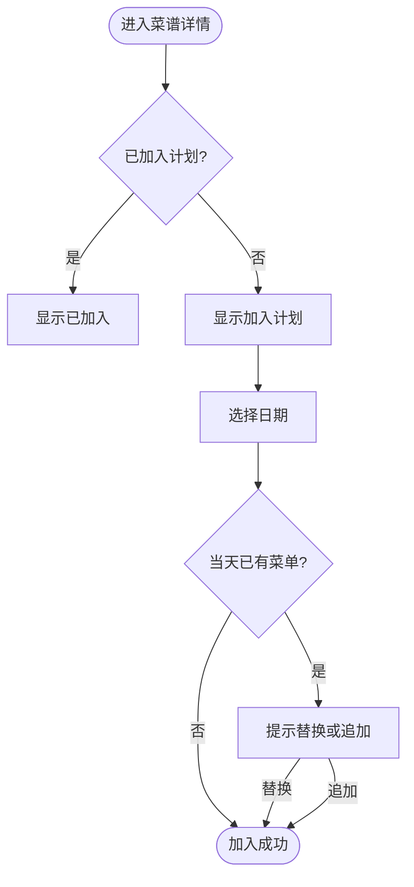
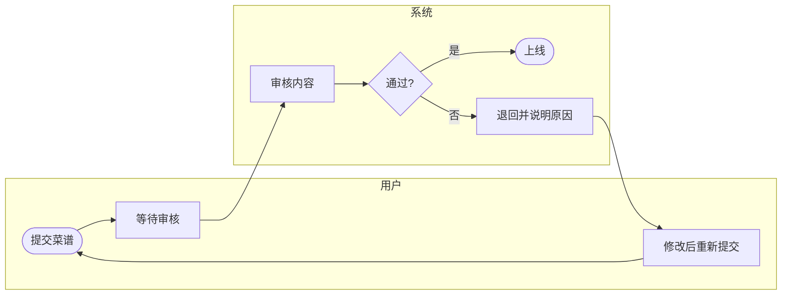

# 需求文档（PRD）

**什么时候写**：从 0 开发（A 起点必须先写，B 起点口头确认后补一份）；要改功能范围或结构时更新；接到"重做一版"时重写。

**什么时候不写**：新增单个功能、小改动、纯 UI 调整——直接改，别为了流程补文档。

**这份文档干什么用**：它不是给老板看的汇报材料，是三件事的依据——**页面该有几页、每页该有什么、哪些失败要兜住**。写不清这三件事，后面写代码时一定边做边改。

---

## 四条硬规矩

**1. 一句话能读完一条。**

功能改成段落、交互写成小作文，等于没写。每一条都要能一眼看出"做完是什么样"。

**2. 区分"用户说的"和"你推断的"。**

用户的原话单独放，不要加工；你自己补的判断标 `（推断）`。分不清这两个，后面改需求时不知道哪条能改。

**3. 没做的要标出来，不能混着写。**

本期先不做的功能、没接通的数据、待确认的规则，全部标 `（本期不做）` `（待确认）`，并汇总进第八节。**不标＝默认要做，最后没人做就是漏项。**

**4. 语气在这里定一次，不留给写页面时再想。**

写 PRD 时就把界面文案语气定下来，**用户没有特别指定，默认「滑稽档」**（口语、短句、用"你"，不加网络烂梗）。用户明确要别的风格（专业、克制、可爱等）就按用户的来。这一条只写档位、三条样例和例外，不抄全站文案；档位参数见 `copywriting.md`，最终落进 `design.md` 的「风格」一节，之后所有页面继承。

---

## 文档结构（八节，顺序别换）

| 节 | 回答什么 | 少了会怎样 |
|---|---|---|
| 一、产品定位 | 给谁，解决什么问题，不解决什么 | 功能范围会自己膨胀 |
| 二、技术栈 | 用什么写、为什么、换不换得动 | 中途换框架＝重写；选完才发现能力不够用 |
| 三、结构与页面 | 几个 tab、多少页、谁进谁 | 做到一半发现漏页、有页没入口 |
| 四、功能清单 | 多少个功能点、哪些本期做 | 工作量估不准，优先级打架 |
| 五、交互 | 每页主角、主动作、四种状态 | 只做出理想态，空/错状态全缺 |
| 六、兜底 | 失败时用户看到什么 | 一出错就白屏 |
| 七、业务流程图 | 主流程怎么走、哪里会断 | 页面之间接不上 |
| 八、未来可迭代 | 这版先做什么之后做、什么条件下做 | 范围越做越大；或者更糟——该做的被写成"永远不做"，下一版没人敢碰 |

**语气不单开一节**，在第五节「交互」末尾补三行：语气档（未指定即滑稽档）、3 条样例、例外清单。它是所有页面共用的一条约束，不按页重复写。

---

## 一、产品定位

```markdown
## 一、产品定位

**一句话**：给【谁】在【什么场景】解决【什么问题】。

**用户原话**
> "……"

**解决的问题**
- 
- 

**不解决的问题（边界）**
- 
- 
- 

**做对了的样子**
用户完成【某个动作】就算这一版做成了。
```

**写得好的标准**

- 一句话里必须同时有 **谁 / 场景 / 问题**，缺一个就还不到位
- "不解决的问题"至少 3 条，这是给自己划范围用的
- 用户原话照抄，不要润色。润色过的原话，以后就查不出真实诉求

**常见错误**

| 错误写法 | 问题 |
|---|---|
| "让做饭更简单" | 宣传语，不是定位。谁？什么场景？解决什么？都没有 |
| "不解决的问题"空着 | 范围必膨胀。这条空着，等于宣告什么都做 |
| 把功能列表当定位 | "有菜谱、有账本、有投票"——这是功能，不是定位 |

**小程序特有的一条**：定位里要能看出**用户多久来一次**。小程序的流量入口是扫码、搜索、分享、下拉最近使用——**低频工具型**产品和小程序的分发方式天然不合。答不出"用户为什么一周会再来一次"，先别往下写。

---

## 二、技术栈

**没定就主动问，别沉默开工。** 已有代码的项目沿用现状、不主动提换；从 0 开发则问一句"打算用什么写"，同时给出**一个**默认推荐。用户说"你定"就直接定，说"我想用别的"就按他的来，只补一句代价。

**默认推荐（按顺序判断，只给一个）：**

| 条件 | 推荐 |
|---|---|
| 只出微信 | **原生 + TypeScript** |
| 要出 H5 / App，熟 Vue | **uni-app** |
| 要出 H5 / App，熟 React | **Taro** |

理由是**少一层东西**：跨端框架的价值是"一套代码多端复用"，只有一端时它带来的是编译层、框架运行时（占主包额度）和新能力晚一步。反过来，明确要多端时才值得背这些。

**这一节只记录决定，不写框架 API。** PRD 是产品文档，`uni.setStorageSync` 这个级别的东西写进技术方案或代码注释；PRD 只记三件事：**用什么、为什么、换不换得动**。

```markdown
## 二、技术栈

**选定**：uni-app + Vue3 + TypeScript

**为什么**：团队熟 Vue；后面可能要出 H5 版本，一套代码两端用。

**它带来的硬约束**：多一层编译，产物带框架运行时，主包 2MB 要算着用；个别原生能力要条件编译。

**能不能换**：不能。换框架等于把页面重写一遍。
```

### 用户反问差异时，用三个问题收敛

用户不满足于默认推荐、想自己判断时，问这三个，问完**给回一个结论**，不要让他自己权衡：

| 问题 | 怎么影响选择 |
|---|---|
| 只做微信，还是要同时出 H5 / App？ | 只做微信 → 原生最省事；要多端，才值得背跨端框架 |
| 团队（或你自己）熟 Vue 还是 React？ | 熟 Vue → uni-app；熟 React → Taro；都不熟 → 原生，学的就是平台本身 |
| 有没有必须先用的能力或组件？ | 去对应生态里先查一遍。查不到，这个选项直接划掉 |

### 三个选项的一句话差别

| 选项 | 是什么 | 什么时候选它 | 代价 |
|---|---|---|---|
| **原生** | 微信官方那套：WXML + WXSS + JS/TS | 只做微信；要稳、要性能；新能力要第一时间用 | 不能多端复用；写法比框架啰嗦；用第三方包要"构建 npm"，产物同样占包体积 |
| **uni-app** | Vue 语法，编译成小程序 / H5 / App | 团队会 Vue；想一套代码多端 | 多一层编译；产物带框架运行时；个别原生能力要条件编译 |
| **Taro** | React 语法，编译成小程序 / H5 / RN | 团队会 React；想一套代码多端 | 同上；多端差异要自己处理；生态比 uni-app 小一些 |

**不要选的**：已停止维护或长期没动静的（wepy、mpvue、Rax 这一类）。判断方法很简单——**看它最近一次发版是什么时候**，一年以上没更新就别碰。

**关于新能力**：微信新出的东西（渲染引擎、新开放能力），原生第一时间能用，跨端框架要等适配。**选了框架，就接受"新能力晚一步"**——别在 PRD 里写"上线就要用最新特性"。

### 选完之后必须写进 PRD 的三件事

1. **框架名 + 语言**（如"原生 + TypeScript"、"uni-app + Vue3"）
2. **它带来的硬约束**：产物怎么构建、有没有运行时体积、哪些能力要条件编译、包体积余量够不够
3. **换不换得动**：写"不能"，并补一句理由

### 两条硬规矩

1. **项目开始后不换技术栈。** 换的代价不是改配置，是把页面重写一遍。真要换，当新项目立项
2. **不因为"别人都在用"就选跨端框架。** 跨端框架解决的是"一套代码多端复用"；你只做微信时，它带来的是额外复杂度，不是收益

### 常见错误

| 错误 | 后果 |
|---|---|
| 看谁火选谁 | 团队不熟，写得慢、踩坑多 |
| 只做微信却选了跨端框架 | 白背一层编译和运行时，还拖慢新能力跟进 |
| 在 PRD 里写框架 API | PRD 变成技术文档，改需求时要连技术一起改 |
| 没写"能不能换" | 中途有人提议换框架，没人拦得住 |

---

## 三、结构与页面

这一节决定工作量的量级，也是**最容易漏**的一节。

```markdown
## 三、结构与页面

**tabBar（2–5 个）**

| tab | 页面 | 从哪进 | 这页主要动作 | 本期做 |
|---|---|---|---|---|
| 菜谱 | 菜谱列表 | 首页 tab | 浏览、进入详情 | 是 |
| 菜谱 | 菜谱详情 | 列表点击 | 看步骤、加入计划 | 是 |
| 菜谱 | 菜谱编辑 | 详情页右上 | 填写并保存 | 是 |
| 我的 | 我的 | 首页 tab | 看统计、进设置 | 是 |

**页面统计**：共 4 个 tab / 18 个页面，本期做 11 个。

**不在 tab 上的一级入口**
- 今晚吃什么（从首页卡片进）
```

**硬规矩**

1. **tab 只能 2–5 个**（微信 tabBar 上限是 5）。想到 6 个，说明有入口该合并或降级
2. **每个页面必须能从上一页点进来。** 写不出"从哪进"的页面，要么补入口，要么删掉——否则就是死页
3. **别按功能列页面。** 一个功能可能跨 3 个页面（列表 → 表单 → 回列表），一个页面也可能装 4 个功能。**这里列的是页面，不是功能**
4. **页面栈最多 10 层。** 设计上别超过 5 层，超过 5 层用户就找不到回去的路了
5. **首页就是落地页。** 用户扫码、点分享卡片进来，**直接落在你指定的页面**，没有浏览器地址栏，也没有"首页"这个东西可以兜回来

**常见错误**

- 只列 tab 首页，把二级页留到"边做边想"——二级页往往比首页更费工
- 把"新增XX"当成独立页面，其实它只是详情页的一个状态
- 一个页面里塞三件事，导致主角说不清（下一节会暴露）

---

## 四、功能清单

```markdown
## 四、功能清单

共 23 个功能点，本期做 15 个。

| 编号 | 功能 | 所属页面 | 一句话行为 | 优先级 | 本期 |
|---|---|---|---|---|---|
| F01 | 菜谱列表 | 菜谱列表 | 按最近更新排序，滚动加载 | P0 | 是 |
| F02 | 菜谱搜索 | 菜谱列表 | 按菜名模糊搜，无结果给空状态 | P0 | 是 |
| F03 | 收藏菜谱 | 详情页 | 点心收藏，列表可筛收藏 | P1 | 是 |
| F04 | 菜谱评分 | 详情页 | 五星打分，一人一次可改 | P2 | 否 |

**优先级定义**
- P0：没有它闭环走不通
- P1：影响体验但能绕过去
- P2：可有可无
```

**硬规矩**

1. **一条功能只用一句话说行为。**"填名称、照片、步骤，保存后回列表"是合格的一句话；"支持增删改查"不合格
2. **每条都能验收。** 验收不了的功能（"体验更流畅"）不是功能，是愿望，删掉
3. **按页面分组统计**，方便和第三节的页面清单对账：每个页面至少挂一个 P0 功能，挂着零个 P0 的页面说明它是次要页
4. **P2 全部移入第八节"未来可迭代"**，除非它顺手就能做

**常见错误**

- 把"页面"当"功能"（"菜谱详情页"是页面，不是功能）
- 一条里塞三个动作，最后只做了两个，验收时说不清
- 优先级全是 P0——等于没有优先级

---

## 五、交互

这一节写的是**用户点了之后发生什么**，不是页面长什么样。页面长什么样在开工前定一次（见 `design.md`：颜色、字号、间距、按钮三态）。

每页一段，模板：

```markdown
### 页面：菜谱编辑页

- **主角**：菜名和照片
- **主动作**：保存（右上角，唯一实心按钮）
- **进入方式**：详情页右上"编辑"，或列表页"+"新建
- **离开方式**：保存成功回详情页；未保存返回时二次确认
- **状态**
  - 空：新建进来，只有占位提示，不给示例数据
  - 加载：保存中，按钮转圈并禁用，防重复提交
  - 出错：保存失败，**保留已填内容**，提示重试，不退出页面
  - 成功：回详情页，轻提示"已保存"
- **反馈**：按下 0.96 缩放；切图 200ms 淡入；超 3 秒无响应显示加载文案
```

**四种状态必须全写**

| 状态 | 不写会怎样 |
|---|---|
| 空 | 空列表变一片白，用户以为坏了 |
| 加载 | 点两次提交，产生两条数据 |
| 出错 | 报错就把页面跳走，用户填的全丢 |
| 成功 | 用户不知道成没成，反复点 |

**小程序特有的交互限制**（写交互时就该避开）

- **没有悬停态**，只有按下态（`hover-class`）
- **页面转场改不了**，所以不要写"页面切换动画"
- **只有左上角返回**，深层页要显式给"回首页"
- **轻提示（toast）会被截断**超过两行，需要两行以上的提示改用弹层
- **弹出键盘会挡住底部**，表单的提交按钮不能固定在最底部
- **下拉刷新默认没有**，要显式开启；上拉加载要写清"到底了"怎么显示

**常见错误**

- 只写理想态，一张"填写完整"的截图就算交互写完了
- 用"点击跳转详情页"这种话代替"点了之后发生什么"
- 写"删除后弹窗确认"却没写弹窗里的两个按钮分别叫什么

---

## 六、兜底

兜底不是"加个 try-catch"，是**用户遇到失败时看到什么、还能不能继续**。逐场景写：

```markdown
## 六、兜底

| 失败场景 | 用户看到什么 | 能否重试 | 数据是否保留 |
|---|---|---|---|
| 无网络 | 显示上次缓存内容 + 顶部"网络异常"条 | 点条重试 | 保留 |
| 请求失败 | 该区域显示错误态 + 重试按钮，页面其余部分照常 | 是 | 保留 |
| 列表为空 | "还没有菜谱，去添加第一道" + 主按钮 | — | — |
| 图片加载失败 | 占位图（不用白块） | 否 | — |
| 权限被拒（相册） | 只提示一次，提供"去设置"，不反复弹 | 手动 | — |
| 未登录 | 可浏览，操作时才引导登录 | 是 | 保留草稿 |
| 数据未接通 | 界面正常，标"本期未接" | — | — |
```

**必须覆盖的七类**（小程序）

1. **无网 / 弱网** —— 弱网（不是断网）比断网更常见，要给超时，别无限转圈
2. **请求失败** —— 错误要局部化：只有那一块失败，不要把整页变成错误页
3. **空数据** —— 空列表必须有引导动作，不能是白屏
4. **图片失败** —— 网络图、用户上传的图都会挂，必须配占位
5. **权限被拒** —— 相册、位置、麦克风、手机号。**拒绝后不要再自动弹**，改为用户主动点
6. **未登录** —— 先说清"哪些能看、哪些要登录"，不要一进来就拦
7. **数据未接通** —— 后端还没做时，界面照做，但要在 PRD 里标 `（本期未接）`，不许用假数据冒充

**一条判断标准**

> 写兜底时问自己：**这个失败发生时，用户手里已经输入的东西还在不在？**
> 不在，就是兜底没做。

**常见错误**

- 只写"加载失败请重试"，没写重试之后还是失败怎么办
- 把技术错误码直接展示给用户（"500"、"errCode: -1"）
- 兜底写成"做好异常处理"——这不是设计，是没想

---

## 七、业务流程图

### 先分清两种图，别混画

| | 业务流程图 | 页面跳转图 |
|---|---|---|
| 画什么 | **用户 / 系统做了什么**，含判断和失败 | 页面之间怎么走 |
| 节点是 | 动作（"提交菜谱"） | 页面（"菜谱编辑页"） |
| 什么时候用 | 有分支、有跨角色、有失败回退 | 页面多、入口绕，怕走丢 |

**PRD 里画业务流程图，不是页面跳转图。** 页面关系第三节那张表已经说清了，不需要再画一遍。

### 什么时候必须画（满足任一）

- 流程跨 **2 个以上页面**
- 有 **判断分支**（是不是、有没有、通过不通过）
- 有 **失败回退**（失败后回到哪一步）
- 涉及 **多个角色**（用户 + 审核 / 商家 / 客服）

单一页面内部的流程（填表单 → 保存）不用画，写在第 5 节的状态里就够了。

### 选图种

| 情况 | 用什么 |
|---|---|
| 只有用户一个角色 | 普通流程图，自上而下 |
| 用户 + 后台审核 / 商家 / 客服 | **泳道图**，每个角色一条泳道 |
| 有状态变化（待支付 → 已支付 → 已核销） | 另画状态图，不要塞进流程图 |

**泳道按角色分，不按页面分。** 把"首页 / 详情页 / 我的"当泳道是常见错误——那是页面，不是谁在做事。

而且**小程序 C 端大多数流程只有用户一个角色**，这时候画泳道是多余的，一条竖线走下来就够。只有真出现"人审"或"多个人参与"时才用泳道。

### 绘制规则

1. **节点只写业务动作。** "提交菜谱""确认菜单"——不写页面名，不加 `010` `A1` 这类编码（除非要对外追踪）
2. **形状必须语义一致**：矩形＝处理动作；菱形＝判断；圆角胶囊＝开始 / 结束。不要为了好看混用
3. **判断节点的出边必须标条件**：`是 / 否`、`成功 / 失败`、`通过 / 退回`。**不标条件的菱形等于没画**
4. **连线横平竖直**，不斜着走，不穿过节点和文字
5. **失败回退用回线**，明确回到哪一步，不要画成"失败 → 结束"
6. **一张图只讲一件事。** 节点超过 12 个就拆成两张，不要硬塞
7. **图中不能有交叉线。** 出现交叉说明流程本身绕，先简化流程，再画图
8. **文字不能溢出节点**。宁可把节点拉宽，不要缩字

### 示例（普通流程图）

````markdown

````

### 示例（泳道图，仅在有多个角色时）

````markdown

````

### 载体怎么选

- **默认写 mermaid 代码块**。PRD 是要被改的文档，mermaid 能直接改、能 diff、在多数编辑器里能预览
- **需要给别人评审、要贴到群里时**，再渲染成 SVG。这一步如果本地有 `flow-canvas` 那类引擎，用它渲染比手画准；没有就用能出图的工具，**不要手写 SVG 坐标**
- **交付前必须自己看一眼图**：有没有交叉、有没有文字压线、判断节点有没有标条件

### 常见错误

| 错误 | 后果 |
|---|---|
| 把页面名当节点 | 画出来的是导航图，流程里的判断和失败全丢了 |
| 菱形不标条件 | 看图的人不知道走哪条 |
| 失败都画成"→ 结束" | 落地时不知道失败后回哪，只能重进 |
| 一张图画完所有流程 | 交叉成网，谁也读不懂 |
| 只画顺利路径 | 兜底那节写的东西在图里找不到位置 |

---

## 八、未来可迭代

这一节**不是"关闭清单"，是下一版的候选池**。写的是"这版先不做"加"什么条件下值得做"，不是"永远不做"。它照样是拒绝需求的依据，但拒绝时给的是条件，不是一句"我们不做"。

```markdown
## 八、未来可迭代

| 功能 | 这版先不做的原因 | 什么条件下做 |
|---|---|---|
| 分享到朋友圈 | 小程序不支持直接分享，要生成图片另存，本版验证不出价值 | 有人反复问"能不能发朋友圈"，或分享率明显低于同类 |
| 多人协作编辑 | 涉及权限与冲突处理，先跑通单机闭环 | 出现两人共用一个家庭账号的真实场景 |
| 消息推送 | 订阅消息要用户主动授权且需模板，没人回访时发出去等于白发 | 有稳定回访（例如周留存过 20%） |
```

**硬规矩**

- 至少 3 条
- **三列都要填满**：只写"不做"不写条件的等于没想清楚；写"以后再说"比不写更糟，因为它假装考虑过了
- 条件必须是**能判断的事实**（"有人反复问"、"留存过 20%"），不写"等有时间了""等资源到位"
- 这一节两头用：**拒绝新增需求时有依据，下一版排优先级时有现成输入**。写空了两头都缺

---

## 写完自检（六条）

1. 一句话定位里，谁 / 场景 / 问题都在吗？
2. 每个页面都有"从哪进"吗？有没有写不出入口的页面？
3. 每个页面至少挂一个 P0 功能吗？
4. 四种状态（空 / 加载 / 出错 / 成功）都写了吗？
5. 兜底表里，**用户已输入的内容会不会丢**，每一行都有答案吗？
6. 流程图里的每条失败路径，能在第六节找到对应兜底吗？

六条全过才算写完。**有一条答不上来，就还没到能开工的程度。**

---

## 与代码的一致性

PRD 写完不是锁死的。每次改完功能，回来看一眼：

- 已实现的，标 ✅
- 实现方式变了但效果一样的，改 PRD 的说法
- 做了但 PRD 里没写的，补进去（**否则下次重构会被当成多余的删掉**）
- PRD 写了但没做的，标 `（未实现）`

**PRD 和代码分叉比没有 PRD 更糟**——分叉之后，没人知道该信哪个。

一句话：**PRD 是这一版的共同口径，不是一次性作业。**

---

## 存量项目加功能：不重写 PRD，但补一段影响面

已经有 PRD 的项目加功能，**不要重写整份文档**。在第四节「功能清单」下面补一段「本次变更影响面」，五行：

| 项 | 写什么 |
|---|---|
| 新增 / 改动的页面 | 哪几页，是新页还是改现有页 |
| 关联的现有功能 | 点名功能编号（F03、F07），不写"相关模块" |
| 共用的组件与状态 | 要复用或要改的公共件 |
| 老数据怎么处理 | 新字段 / 新状态遇到老记录时显示什么 |
| 需要回归的页面 | 交付前必须再走一遍的那几页 |

五行写完再开工。**没这一段，加功能就是在赌它不撞车。**

影响面分级见 `existing-project.md`。波及页面多不等于要做 HTML：正式视觉稿已确认、交互清楚时即可按稿开发；用户明确要求 HTML 或有具体交互待验证时，才按最小必要范围补原型（见 `html-prototype.md`）。

---

## 交付前对照 PRD（四问）

上面的"写完自检"是**能不能开工**；这一份是**做完了没有**。交付前把 PRD 摊开逐条对，**不要凭记忆**——凭记忆对出来的永远是"都做了"。

### 先数数

开工前把这三个数记下来，交付时给出实际值：

| 数 | 从 PRD 哪节取 | 交付时报 |
|---|---|---|
| 页面数 | 第三节 | 做了 x / 共 y 页 |
| P0 功能点数 | 第四节 | 做了 x / 共 y 个 |
| 有失败路径的流程数 | 第七节 | 每条都有兜底 / 缺几条 |

**给出"15 / 15"比"基本完成"有用一百倍。** 数字对不上，就是有漏项，不用争。

### 四问

| # | 查什么 | 怎么查 | 不过怎么办 |
|---|---|---|---|
| 1 | **页面清单** | 第三节每一页，代码里有对应页面文件、`app.json` 里有注册或入口吗 | 没做的标 `（未实现）` 并写原因；有页面没入口的，补入口或删页 |
| 2 | **功能点** | 第四节每个 P0，界面上有能点到的入口吗 | 找不到入口＝没做。别把"代码里写了函数"算成做了 |
| 3 | **四种状态** | 第五节每页的空 / 加载 / 出错 / 成功，都能看到吗 | 当场补；补不了的，交付说明里点名"哪页缺哪种状态" |
| 4 | **兜底** | 第六节每条失败路径，触发时用户看到什么、已输入的内容还在吗 | 内容丢了就是兜底没做，先修再交付 |

### 结论怎么写

三句话，写进交付说明：

1. **做完了哪些**：按上面的 x / y 报
2. **哪些没做**：逐条列，每条一句为什么（时间、缺素材、依赖外部、判断不值得）
3. **哪些改了说法**：PRD 写 A，实际做成 B 的，说清为什么改，并**回写 PRD**

**禁止的写法**："基本完成""主要功能都已实现""细节待打磨"——这三句等于没说，用户无法判断能不能用。

### 一条硬规矩

**交付时改了说法的，必须当场回写 PRD。** 不回写的后果是下一轮对照全部失真：PRD 说 A、代码是 B、谁也不知道该信哪个。**PRD 与代码分叉，比没有 PRD 更糟。**
